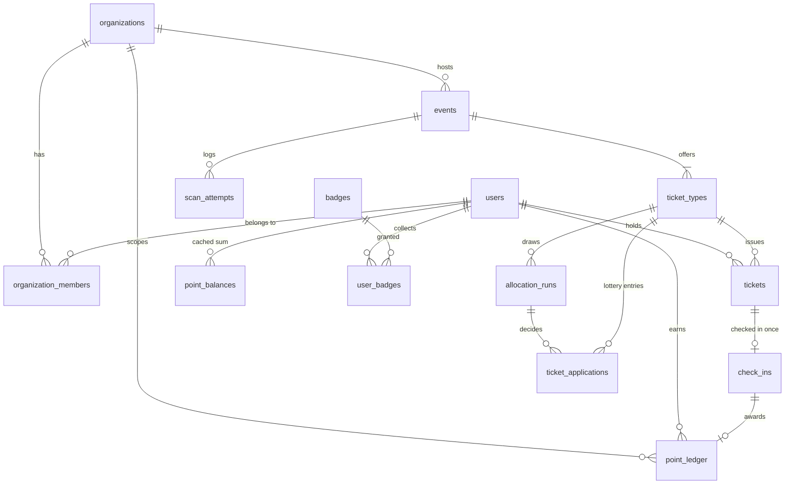
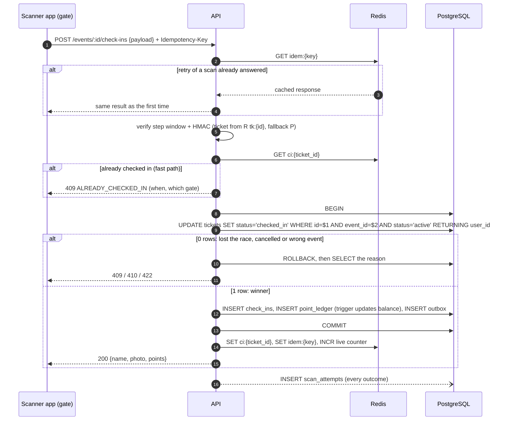

# Architecture

Etkin is an event ticketing, dynamic-QR check-in and loyalty platform for university
communities. This document records the design decisions; the schema itself lives in
[`db/migrations`](../db/migrations) and its invariants are tested in
[`db/tests/schema.test.mjs`](../db/tests/schema.test.mjs).

## 1. Stack

| Layer | Choice | Why |
|---|---|---|
| API | Node.js LTS + TypeScript + Fastify | One language end to end: request/response schemas (zod) and the QR token library are shared with the mobile app. Door traffic for a campus event (hundreds of scans per minute) is far below what a single Node process handles. |
| DB access | Kysely + kysely-codegen | SQL-first and fully typed from the real schema; conditional updates and row locks stay explicit instead of hidden behind an ORM. |
| Migrations | dbmate (plain SQL, up + down) | Reviewable SQL, partial indexes, triggers and composite FKs without ORM workarounds. |
| Database | PostgreSQL 18 | Source of truth. Native `uuidv7()` gives time-ordered keys with good index locality. |
| Cache | Redis (ElastiCache for Valkey on AWS) | Ticket validation cache, fast duplicate rejection, idempotency responses, rate limits, live counters. Never the source of truth. |
| Mobile | Expo (React Native) + Expo Router | `expo-camera` scanning, `expo-secure-store` for QR keys, `expo-screen-capture` to block screenshots, EAS Build → Play Store AAB. Organizer dashboard runs on Expo Web from the same codebase. |
| Tests | Vitest, Testcontainers, PGlite, k6 | PGlite for fast schema tests, Testcontainers for real concurrency, k6 for gate load tests. |
| Infra | AWS via Terraform | ECS Fargate, RDS, ElastiCache, ALB, ECR, Secrets Manager, CloudWatch. GitHub Actions deploys with OIDC (no long-lived AWS keys). |

## 2. Data model



**Roles are per organization** (`organization_members.role`: owner / organizer / scanner),
not global. A student can run one club's events and attend another's with one account.
`users.platform_role = 'admin'` is reserved for platform operators.

**Points are scoped to the organization that awarded them.** The profile shows a total
and a per-club breakdown. Eligibility for a club's VIP events uses that club's points.

### Invariants enforced by the database

| Invariant | Mechanism |
|---|---|
| A ticket type is never oversold | `CHECK (issued_count BETWEEN 0 AND capacity)` + conditional `UPDATE ... WHERE issued_count < capacity` |
| One live ticket per user per event | Partial unique index `(event_id, user_id) WHERE status <> 'cancelled'` |
| A ticket's event matches its ticket type | Composite FK `(ticket_type_id, event_id)` |
| A ticket is checked in at most once | Conditional status transition + `UNIQUE (ticket_id)` on `check_ins` |
| A check-in matches its ticket's holder and event | Composite FK `(ticket_id, event_id, user_id)` |
| A check-in awards points at most once | Partial unique index on `point_ledger (check_in_id)` |
| Point history cannot be rewritten | `point_ledger` is append-only (trigger rejects UPDATE/DELETE); corrections are `reversal` rows |
| Balance never goes negative, and always equals the ledger | Trigger updates `point_balances` in the same transaction; `CHECK (balance >= 0)` |
| Spending points does not lower priority rank | `lifetime_earned` ignores redemptions and is what eligibility reads |

## 3. Authentication

- **Passwords** are hashed with argon2id at the OWASP baseline (19 MiB, t=2, p=1). Login runs a
  dummy verification for unknown emails and returns the same `INVALID_CREDENTIALS` error, so
  neither the response nor its timing reveals which emails are registered.
- **Access tokens** are HS256 JWTs that live 15 minutes and carry only the user id and the
  platform role. Club roles are looked up per request, so removing an organizer takes effect
  immediately.
- **Refresh tokens** are opaque 256-bit values. Only their SHA-256 is stored, and each one is good for
  30 days and one use. Every refresh retires the presented token and issues a new one in the same
  *family*. If a retired token is presented again, a copy has leaked: the whole family is revoked
  and both holders have to log in again. The mobile client therefore runs refreshes single-flight.
- **Rate limits.** Login is limited to 10 attempts per minute per IP + email, and sign-up to
  30 per minute per IP. A campus Wi-Fi shares one public IP across a lecture hall, so a plain
  per-IP login limit would lock out legitimate students.

## 4. Dynamic QR codes

Goal: a screenshot or a forwarded image stops working within seconds, and the code works
at a door with poor mobile signal.

**Key derivation.** No QR secret is stored in the database:

```
ticket_key = HMAC-SHA256(QR_MASTER_KEY, "etkin/qr/v1" || ticket_id || qr_key_version)
```

`QR_MASTER_KEY` lives in AWS Secrets Manager. Leaking the database does not leak
working codes, and bumping `tickets.qr_key_version` invalidates every code issued so far.

**Delivery and device binding.** `GET /tickets/:id/qr-key` returns `ticket_key` and the
server time. The app stores the key in `expo-secure-store` (Android Keystore). The ticket is
bound to the requesting `device_id`. A request from a new device bumps `qr_key_version`, so
the old device's codes die. Device switches are rate limited, which stops the account from
being handed back and forth.

**Code generation (offline, in the app).** Every 15 s:

```
step    = floor((device_time + server_offset) / 15)
mac     = HMAC-SHA256(ticket_key, ticket_id || step)[0..16]
payload = "E1." + base64url(ticket_id(16 B) || step(4 B) || mac(16 B))
```

That is about 51 characters, which gives a small QR that scans quickly. `server_offset`
corrects phones with a wrong clock. The ticket screen blocks screenshots on Android
(`FLAG_SECURE` through `expo-screen-capture`) and shows a moving countdown, so staff can tell a
live screen from a picture.

**Verification (server).** Parse the payload. Check that `step` is within ±1 of server time,
so a code lives for 15 to 45 s. Derive `ticket_key` from cached ticket data, recompute the
MAC and compare in constant time.

**Residual risk, accepted.** A user on a rooted phone can extract `ticket_key`. The
mitigation is human: a successful scan shows the holder's name and photo on the scanner.

## 5. Check-in and double-scan prevention



**Why two simultaneous gates cannot both win.** Both requests can pass the Redis fast path,
because neither has committed yet. Both then run the same conditional `UPDATE`. PostgreSQL
takes a row lock, so the second transaction waits. When the first commits, the second
re-evaluates `status = 'active'` against the new row version (READ COMMITTED re-check),
finds `checked_in`, and updates 0 rows. Exactly one transaction wins, with no
`SERIALIZABLE` retries and no distributed lock. `UNIQUE (ticket_id)` on `check_ins` is the
backstop if a future code path skips the conditional update.

**Redis is an accelerator, not a guard.** If Redis is down or loses data, check-ins still
work correctly, only slower. Redis writes happen after commit, so a failed transaction can
never leave a ticket wrongly marked as used.

**Idempotent retries.** A gate on bad Wi-Fi retries on timeout. Without care, the retry would
show "already checked in" for the attendee's own first scan. The scanner sends an
`Idempotency-Key` per physical scan. The response is cached in Redis, and `check_ins.idempotency_key`
covers the case where Redis lost it. A retry therefore returns the original success.

**Side effects stay out of the hot path.** Badge evaluation, push notifications and the live
dashboard read from the transactional `outbox`. A worker claims rows with
`FOR UPDATE SKIP LOCKED`, so a check-in commits in a few milliseconds and side effects are
never lost.

## 6. Priority and lottery allocation

`ticket_types.allocation_mode`:

- **fcfs.** First come, first served. Requires `min_points_required` points from the club.
- **priority.** Members with at least `priority_points_threshold` points can claim from
  `priority_sales_starts_at`. Everyone else can claim from `sales_starts_at`.
- **lottery.** Users apply until `sales_ends_at`. The draw is a weighted random sample without
  replacement (Efraimidis–Spirakis: `key = u^(1/w)`, take the top *k*). The weight grows with
  recent `lifetime_earned` and shrinks with the no-show rate (tickets issued but never checked in).
  The run's `seed` is stored and published, so anyone can replay the draw and verify it was fair.

## 7. Deployment (AWS)

```
Route 53 → ALB (HTTPS) → ECS Fargate: api (2 tasks) + worker (1 task)
                              ├── RDS PostgreSQL 18 (private subnet)
                              └── ElastiCache for Valkey (private subnet)
ECR (images) · Secrets Manager (DB creds, JWT keys, QR master key) · CloudWatch logs and alarms
```

Terraform state lives in S3 with native lockfile locking. CI runs on every PR: lint,
typecheck, unit tests, schema tests and Testcontainers. CD runs on `main`: build the image,
push it to ECR, run `dbmate up` as a one-off ECS task, then roll out the service.

To keep the bill low for a student project, the Fargate tasks run in public subnets with
locked-down security groups instead of behind a NAT gateway. The stack is designed to be
`terraform destroy`-ed between demos.

## 8. Roadmap

| Week | Dates | Backend | Mobile / infra | Done when |
|---|---|---|---|---|
| 1 | Nov 2–8 | **T1.1 repo, schema, local infra** ✅ · **T1.2 Fastify skeleton (config, pino logs, problem+json errors, OpenAPI, health, Docker image)** ✅ · **T1.3 auth (argon2id, JWT + rotating refresh) and org RBAC** ✅ · **T1.4 organizations, events, ticket types CRUD** ✅ | T1.5 GitHub Actions CI · open a Play Console account (identity verification takes days) | Swagger: register, create a club, publish an event; CI green |
| 2 | Nov 9–15 | Ticket claim (capacity guard, idempotency) · shared QR library · check-in endpoint, ledger, outbox worker · attendance analytics queries | Concurrency test (50 parallel scans of one ticket, exactly 1 success) · k6 gate load test · first internal Android build to start Play closed testing | Race-condition test and k6 report in the README |
| 3 | Nov 16–22 | Badge rules worker · push notifications | Expo app: auth, event feed, my tickets with live QR, profile (points, badges, history) · organizer mode: create event, scanner screen, live attendee list | End-to-end demo on a real Android phone |
| 4 | Nov 23–29 | Priority and lottery allocation · account deletion (KVKK and Play policy) | Terraform AWS stack · CD pipeline · Play Store listing, privacy policy, Data safety form | Public demo URL, app in closed testing, polished README with architecture and demo video |

**Play Store timing.** New personal developer accounts must run a closed test with at least 12
testers for 14 consecutive days before production access. Club members are the testers. The
closed test starts at the end of week 2 so the 14 days fit inside the month.
